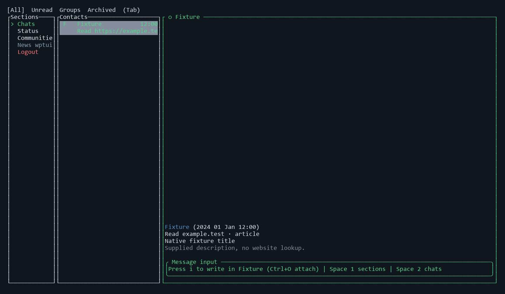
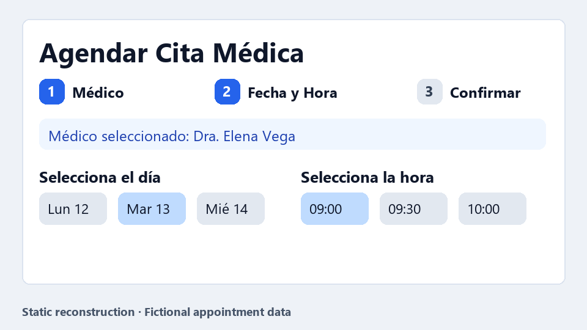
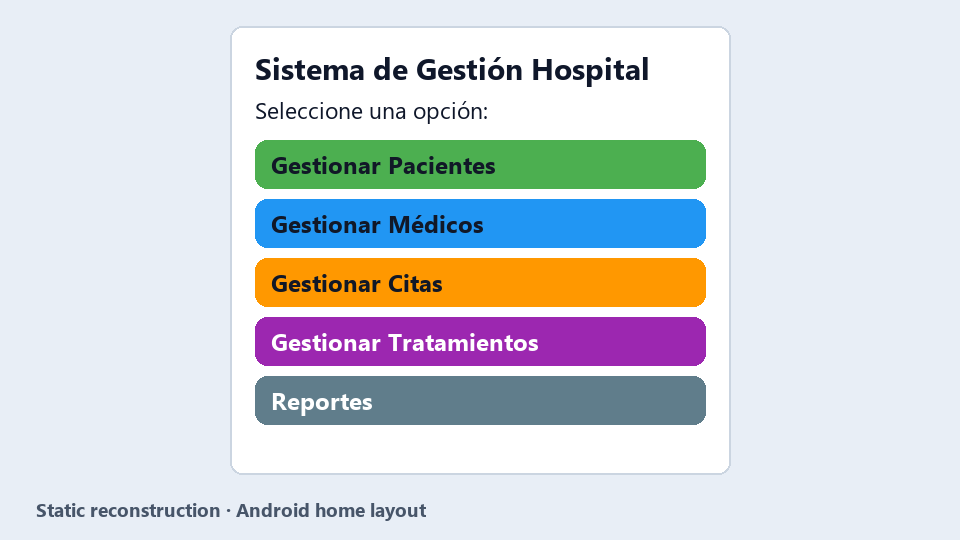
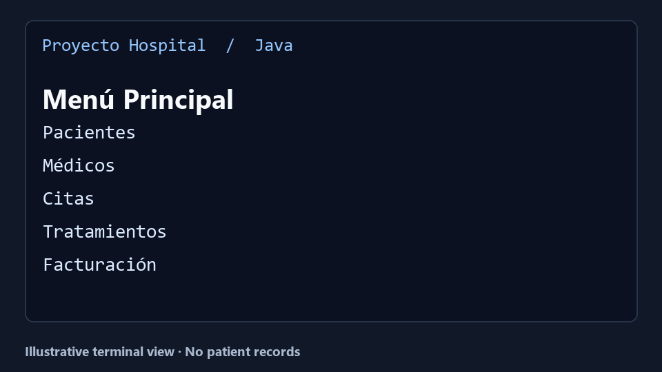
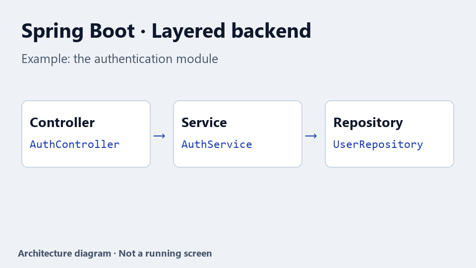
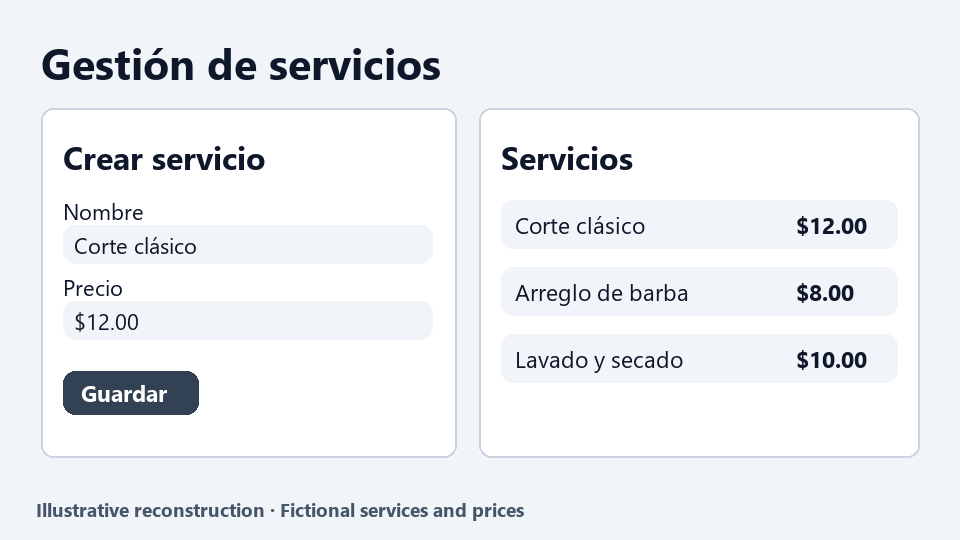
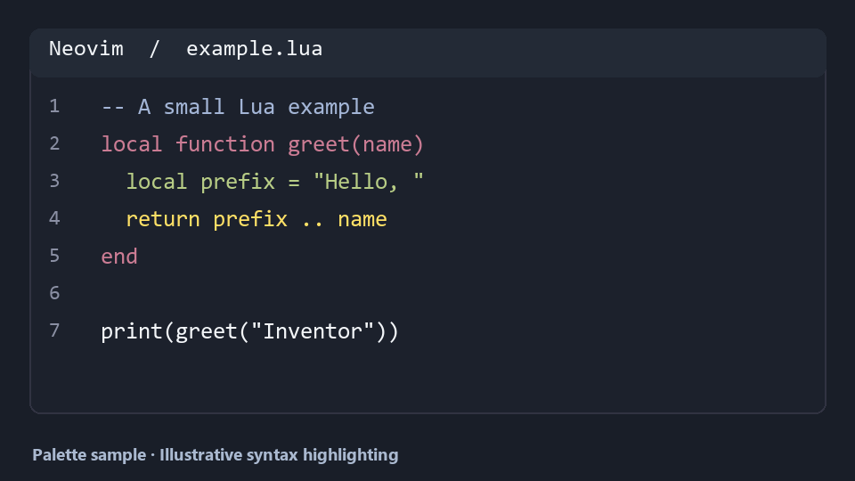

# Hi, I'm Andrei Véliz 👋

I'm a mechatronics engineering student in Ecuador. I build open-source software and design mechanical assemblies.

## Featured work

| Dev | CAD |
| :--- | :--- |
| **[wptui](https://github.com/Andiveli/wptui)** · Rust & Go  Keyboard-driven WhatsApp client for the terminal. [Demo in the project README](https://github.com/Andiveli/wptui#readme) | **[Staircase assembly](https://github.com/Andiveli/Portafolio-CAD/tree/main/projects/staircase)** · Inventor  Site measurements, structural calculations, and technical drawings. |
| **[Hospital web app](https://github.com/Andiveli/HospitalFront)** · Angular & NestJS  Appointment scheduling and clinical workflows for patients, doctors, and admins. | **[Articulated arm](https://github.com/Andiveli/Portafolio-CAD/tree/main/projects/articulated-arm)** · Inventor  Mechanical assembly with a geared linkage and gripper. |

[View the full CAD portfolio](https://github.com/Andiveli/Portafolio-CAD)

## Hospital management project

This started as a Java course project. I revisited the same scheduling and patient-management workflows as an Android app and later as a web application with a separate API and frontend.

| Web app · Angular & NestJS | Android app · Java |
| :--- | :--- |
|  |  |
| Patient, doctor, and admin workspaces for appointments, clinical records, prescriptions, referrals, and video consultations. | Mobile screens for patients, doctors, appointments, treatments, and reports. ViewModels and repositories separate the UI from file-based storage. |
| [Angular frontend](https://github.com/Andiveli/HospitalFront) · [NestJS API](https://github.com/Andiveli/HospitalNestjs) | [Android source](https://github.com/Andiveli/App-hospital) |

| Console app · Java | Layered backend · Spring Boot |
| :--- | :--- |
|  |  |
| The original course project: patient and doctor records, appointments, treatments, and billing with text-file storage. | An experiment separating controllers, services, and repositories. It explores registration and login with Spring Security, JPA, and MariaDB; the authentication flow is incomplete. |
| [Console source](https://github.com/Andiveli/Proyecto-Hospital) | [Backend source](https://github.com/Andiveli/HospitalCapas) |

## More projects

| Salon management · React | samael-purple-night · Neovim |
| :--- | :--- |
|  |  |
| Frontend for account and service management. The companion Express API handles users, services, and appointments. | A Lua colorscheme with a custom purple palette and plugin-specific highlights. |
| [React frontend](https://github.com/Andiveli/frontend-peluqueria) · [Express API](https://github.com/Andiveli/backend-peluqueria) | [Colorscheme source](https://github.com/Andiveli/samael-purple-night) |

**[mcp-cad](https://github.com/Andiveli/mcp-cad)** is a C#/.NET MCP server that automates Autodesk Inventor operations, including sketches, extrusions, and assemblies.

I'm interested in embedded systems and security for robotics.

[GitHub stats](https://github-readme-stats.vercel.app/api?username=Andiveli&show_icons=true&theme=tokyonight)
